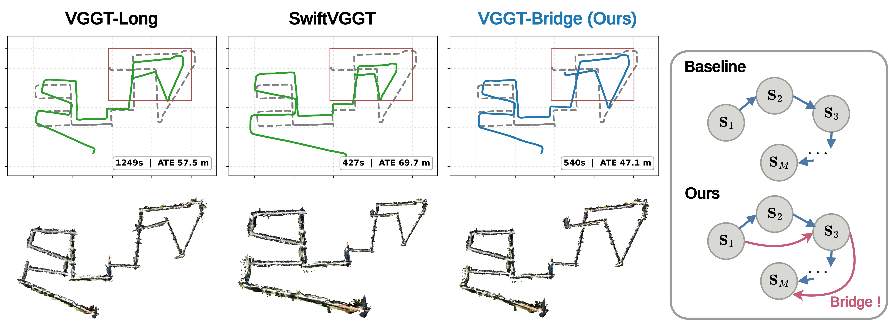

# VGGT-Bridge: Beyond Sequential Pose Graphs via Coarse-Stride Skip Edges

**ACCV 2026** | [Paper (arXiv)](https://arxiv.org/abs/2610.06594)



Prior methods connect only sequentially adjacent chunks, so per-frame errors accumulate along the chain into large-scale drift.
VGGT-Bridge inserts skip edges (pink arcs) that directly constrain non-adjacent chunks under the chunk-and-align pipeline.
On KITTI Odometry Seq. 08, these long-range constraints lower ATE RMSE to 47.1 m.

## Overview

VGGT-Bridge builds on [SwiftVGGT](https://github.com/Jho-Yonsei/SwiftVGGT).
It adds coarse-stride skip edges (strides 3 and 5) to the chunk pose graph,
and reverse-anchors the stride-3 chunks away from loop closures to counter the forward scale bias of chunk-and-align.

## Installation

```
conda create -y -n vggtbridge python=3.10.18
conda activate vggtbridge

pip install torch==2.3.1 torchvision==0.18.1 torchaudio==2.3.1 --index-url https://download.pytorch.org/whl/cu121
pip install -r requirements.txt

python setup.py install
```

Download the VGGT checkpoint.

```
mkdir -p ckpt
wget -P ckpt https://huggingface.co/facebook/VGGT_tracker_fixed/resolve/main/model_tracker_fixed_e20.pt
```

## Reproducing the paper

All benchmarks share the settings in `scripts/common.sh`, which are also the defaults of `run.py`.

```
bash scripts/run_kitti.sh  <kitti_root>  results/kitti
bash scripts/run_vkitti.sh <vkitti_root> results/vkitti
bash scripts/run_waymo.sh  <waymo_root>  results/waymo
```

Each run writes `camera_poses.txt` to its output folder.
When `--gt_pose_path` is given, `run.py` also writes `result.txt` with the translation ATE after Sim(3) alignment, which is the metric reported in the paper.
Add `--full_ate` to also write the full-transformation ATE to `result_full.txt`.
The same metrics can be computed from saved poses.

```
python scripts/eval_ate.py --gt <gt_poses.txt> --est results/kitti/00/camera_poses.txt [--full]
```

## Custom data

The defaults of `run.py` are the settings used in the paper.

```
python run.py --image_dir <image_dir> --output_path <output_dir> --save_points
```

To run the SwiftVGGT baseline, disable the skip edges with `--coarse_strides ''`.
To keep every coarse chunk forward-anchored, pass `--adaptive_strides ''`.

## Acknowledgements

This work was supported by Institute of Information & Communications Technology Planning & Evaluation (IITP) grant funded by the Korea government (MSIT) (RS-2024-00439020, Developing Sustainable, Real-Time Generative AI for Multimodal Interaction, SW Starlab).

This repository is built upon [SwiftVGGT](https://github.com/Jho-Yonsei/SwiftVGGT) ([paper](https://arxiv.org/abs/2511.18290)), and also uses code from [VGGT-Long](https://github.com/DengKaiCQ/VGGT-Long) ([paper](https://arxiv.org/abs/2507.16443)), [VGGT](https://github.com/facebookresearch/vggt), and [FastVGGT](https://github.com/mystorm16/FastVGGT).
We thank the authors for releasing their code.

## Citation

If you find our work useful in your research, please consider citing:

```
@article{choi2026vggt,
  title={VGGT-Bridge: Beyond Sequential Pose Graphs via Coarse-Stride Skip Edges},
  author={Choi, Sungjae and Bae, Hanna and Baek, Sunghyun and Kim, Junmo},
  journal={arXiv preprint arXiv:2610.06594},
  year={2026}
}
```
